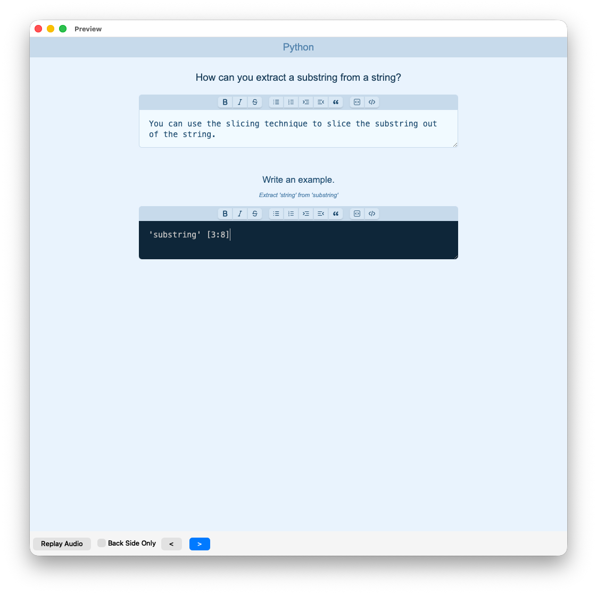
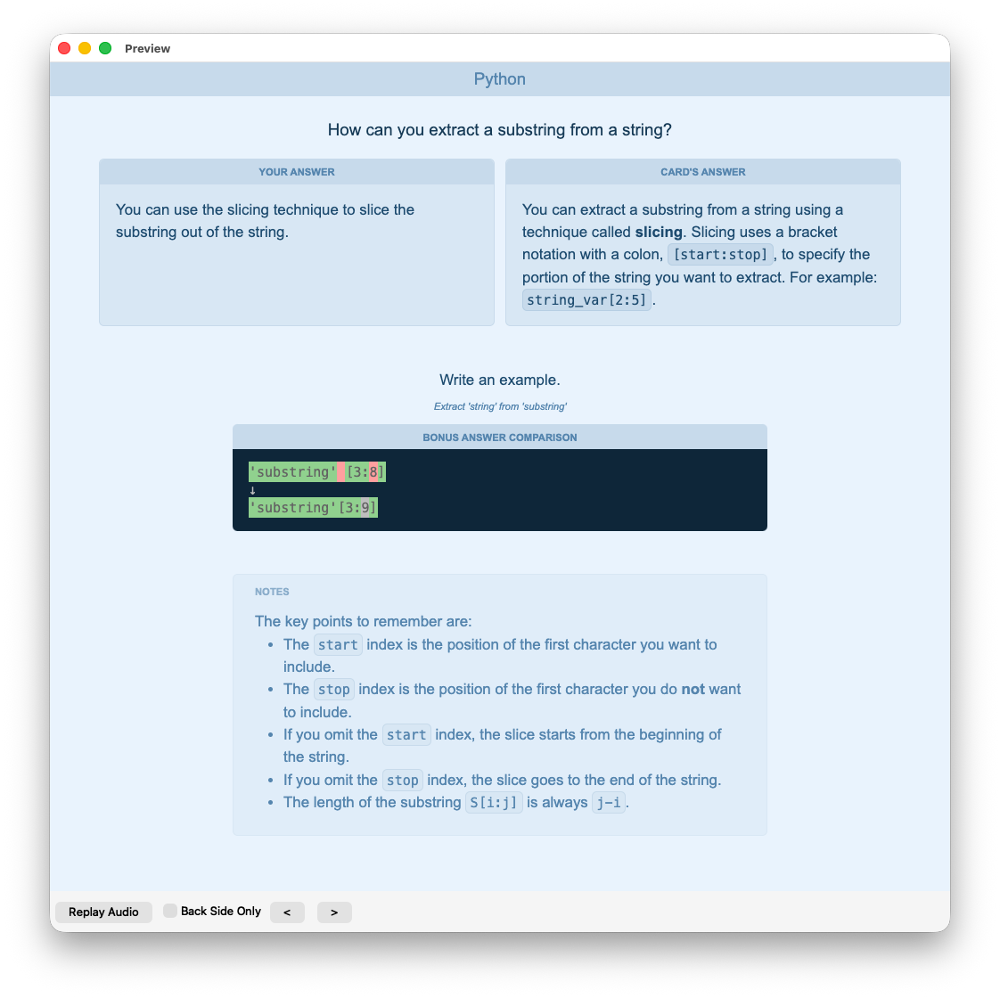
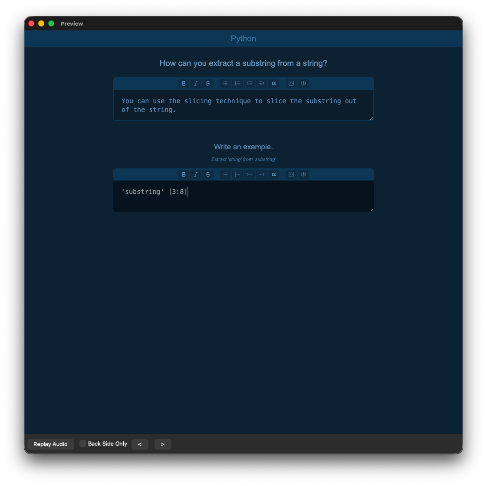
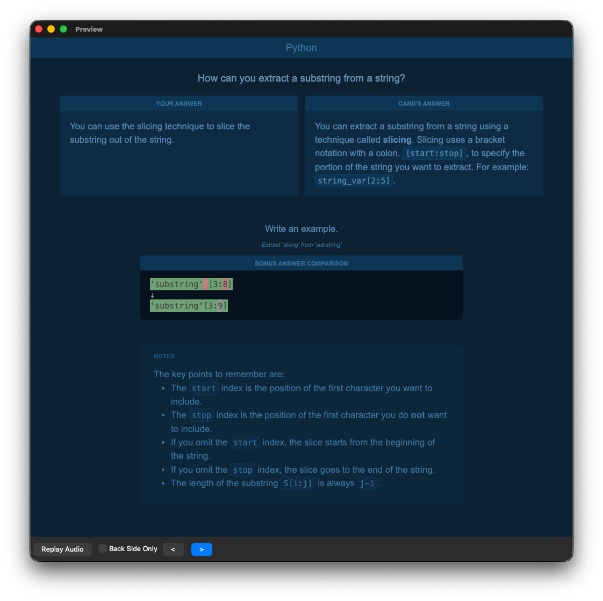
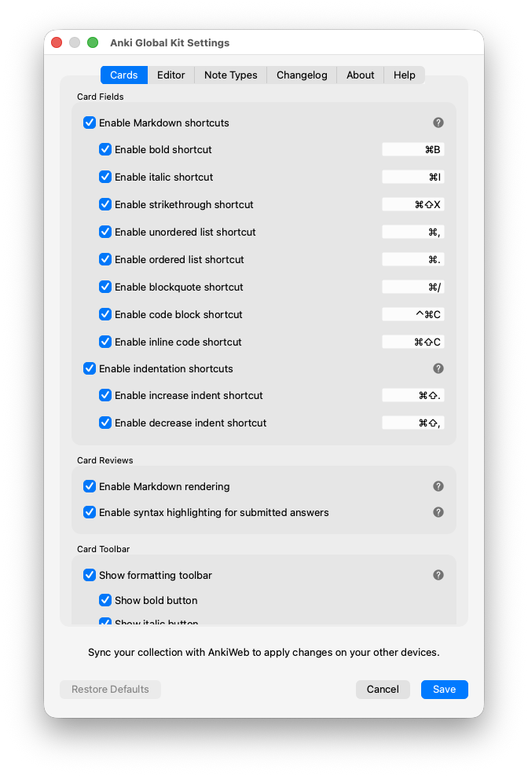
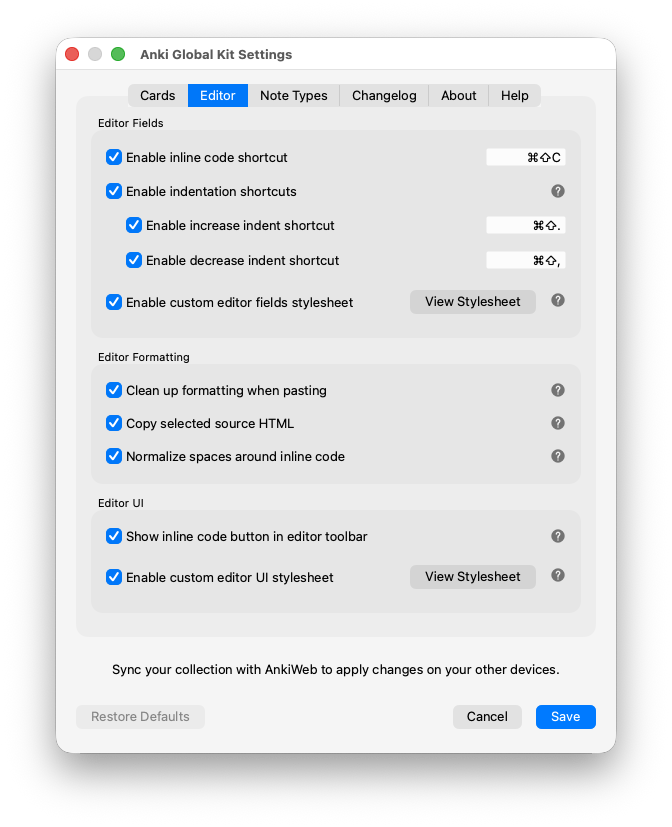
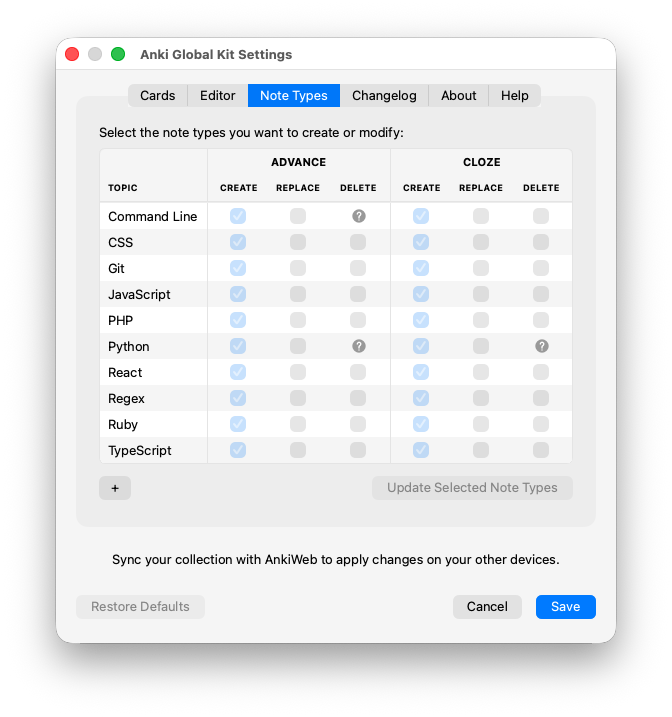
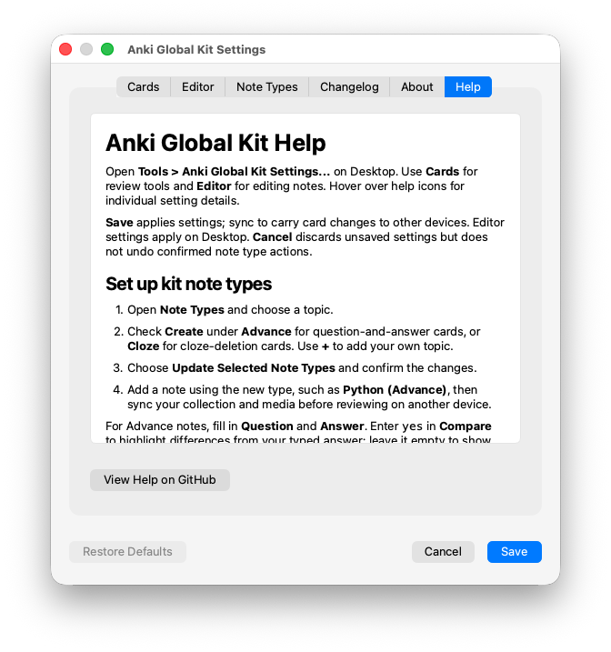

# Anki Global Kit README


## Contents

- [Features](#features)
  - [Global card experience](#global-card-experience)
  - [Typed answers and comparison](#typed-answers-and-comparison)
  - [Markdown answer rendering](#markdown-answer-rendering)
  - [Syntax highlighting](#syntax-highlighting)
  - [Card review dynamic code highlighting](#card-review-dynamic-code-highlighting)
  - [Desktop editor tools](#desktop-editor-tools)
  - [CSS editor injections](#css-editor-injections)
- [Setup](#setup)
- [Templates](#templates)
- [Development](#development)
- [Help and feedback](#help-and-feedback)
- [License](#license)

Anki Global Kit is an Anki Desktop add-on that adds reusable card tools and editing features with a global reach. Set it up on Desktop, then sync your collection and media so supported card features work in Anki Desktop, AnkiWeb, AnkiMobile, and AnkiDroid. The Desktop editor and settings panel remain Desktop tools.

Requires **Anki Desktop 26.05 or later**.

For setup details, shortcuts, customization, and troubleshooting, read the [user guide](addon/desktop/settings/pages/help/help-content.md). The same guide is available in the Anki Global Kit Settings panel's **Help** tab.

## Features

### Global card experience

Create reusable topic-based Advance and Cloze note types, then sync the collection and media to review them across Anki Desktop, AnkiWeb, AnkiMobile, and AnkiDroid.

#### Card layouts and themes

Responsive card layouts include question and answer areas, comparison panels, cloze deletions, hints, bonus sections, and notes. Shared typography, light and dark palettes, topic accent colors, and AnkiWeb study menu adjustments are included with the synced card styles.

The front shows the question, typed answer fields, formatting toolbar, and optional hint. On the back, the typed answer appears alongside the card's reference answer; bonus comparison and notes can appear below. These examples use a Python Advance note in light and dark themes.

| Card preview                                                                                                                     |
| -------------------------------------------------------------------------------------------------------------------------------- |
| **Light theme — front of card**                                                                                                  |
|  |
| **Light theme — back of card**                                                                                                   |
|      |
| **Dark theme — front of card**                                                                                                   |
|                  |
| **Dark theme — back of card**                                                                                                    |
|        |

### Typed answers and comparison

Multiline inputs support primary and optional bonus answers, type hints, and notes. Typed responses are retained for display on the card back. Enable comparison to show character-level matches, mistakes, and omissions beside the reference answer. Review input shortcuts and toolbar options are configured under **Cards**.

### Markdown answer rendering

Turn on **Markdown to HTML rendering** in **Cards → Card Reviews** to format submitted answers. An optional toolbar and configurable shortcuts make it easier to enter Markdown while reviewing. The settings control both the toolbar and individual actions.

### Syntax highlighting

Set languages, themes, and line display options under **Syntax Highlighting**. The editor can save highlighted blocks in notes, and review-time highlighting can format code in submitted answers. Highlighted blocks and their card styling sync across supported apps.

#### Card review dynamic code highlighting

Turn on submitted-answer highlighting in **Cards → Card Reviews** to highlight code fences in typed answers when revealed. The language label or card topic determines the highlighting language.

#### Code Block Options

The Desktop editor can add highlighting, line numbers, and cloze behavior to saved code blocks. **Code Block Options** configures line numbering and the starting line for each block; **Copy code** can be enabled for newly created blocks.



### Desktop editor tools

The Desktop editor adds formatting buttons and shortcuts, code highlighting, Markdown conversion, and optional toolbar controls. These tools run on Desktop; authored note content can then appear on synced cards.

#### Editor toolbar and shortcuts

Configure editor actions and shortcuts under **Editor**. **Show custom formatting toolbar** controls Kit buttons, and **Show Syntax Highlighting button** controls the Highlight Code menu and Code Block Options.



### CSS editor injections

Under **Editor Styles**, independently enable the kit's default field and interface styles or provide a custom stylesheet for either area. These CSS injections customize the Desktop editor; card appearance is controlled by synced card styling.

## Setup

1. Install [Anki Desktop 26.05 or later](https://apps.ankiweb.net/). Install the kit using its AnkiWeb download code through **Tools > Add-ons > Get Add-ons**, or download `anki-global-kit.ankiaddon` from [GitHub Releases](https://github.com/jacobcassidy/anki-global-kit-addon/releases) and choose **Install from file**. Restart Anki after installation. See the [Anki add-on instructions](https://docs.ankiweb.net/addons.html); to build a package from this repository, see **Development** below.
2. Open **Tools > Anki Global Kit Settings... > Note Types**. Check **Create** for the topics and formats you want: **Advance** for question-and-answer cards or **Cloze** for cloze-deletion cards. Use **+** to add a custom topic.
3. Choose **Apply Selected Changes** and confirm. Add a note using a new type, such as **Python (Advance)** or **CSS (Cloze)**.
4. Adjust review tools in **Cards** and Desktop editing tools in **Editor**, then choose **Save**.
5. Sync the collection and media from Desktop, then sync your other devices before reviewing there.

The add-on automatically installs or refreshes its managed card scripts, stylesheets, font, and combined font license notice in the active profile when it opens, when you switch profiles, and when you save settings. You do not need to copy media files or card templates manually for newly created kit note types.

### Create and update note types

Built-in topics include Command Line, CSS, Git, JavaScript, PHP, Python, React, Regex, Ruby, TypeScript, Vocabulary, and WordPress. Custom topics use the kit's default styling.

- **Create** adds a missing note type. Existing types are detected and checked automatically.
- **Replace** updates an existing type's first card template and styling after explicit selection and confirmation. Notes and fields are kept, and missing kit fields are added. For standard note types, additional card templates and their associated cards are removed, including those cards' scheduling. The confirmation lists the affected note types, additional template names, and template and card removal counts.
- Replacement requires the existing type to match the selected format: a standard note type for **Advance**, or a Cloze note type for **Cloze**. A type's name alone does not determine its format.
- **Delete** removes an empty note type or an uncreated custom topic. Types containing notes cannot be deleted through this panel.

Choose **Apply Selected Changes** to apply these actions. The kit rechecks the active collection, selected note types, and template and card removal counts after confirmation. If they have changed, it stops and asks you to review and confirm again. Anki refreshes after applied note type changes. **Save** applies settings separately; **Cancel** does not undo confirmed note type changes. Pending action checkboxes are not retained across restarts, while custom topics remain available.

The **Note Types** tab lists the available topics and lets you choose which Advance or Cloze types to create, replace, or delete. Use **+** to add a custom topic.

Under **Syntax Highlighting → Themes**, choose **Enable Code Styling…** to add only the `_syntax-highlighting.css` import to any existing note type after confirmation. This preserves fields, templates, notes, cards, and other styling, and works with ordinary note types that do not use the kit layout.



Sync all devices before replacing or deleting note types. If Anki requests a full sync afterward, choose **Upload** on the Desktop where you applied the changes, then **Download** on your other devices. See [Anki's sync conflict guidance](https://docs.ankiweb.net/manual/syncing#conflicts) for details.

### Add your first note

For an **Advance** note, fill in **Question** and **Answer**. Enter `yes` in **Compare** to highlight differences between your typed answer and the reference; leave it empty to display the answers separately. **Type Hint**, bonus question and answer fields, and **Notes** are optional. **Bonus Compare** enables comparison for the bonus answer.

For a **Cloze** note, use **Cloze Question** and Anki's cloze-deletion tools. The primary typed answer is compared automatically; bonus fields and notes are optional.

### After an add-on update

Restart Anki Desktop so the updated card assets are installed, then sync the collection and media. Existing note templates are not updated automatically. If you want to apply the latest kit templates, select **Replace** for the relevant types in **Note Types** and confirm.

Updates keep your saved shortcuts. The editor now uses **Command+Option+8/9/0** on macOS (**Ctrl+Alt+8/9/0** on Windows/Linux) for **Bullet List**, **Numbered List**, and **No List**. To adopt these card defaults, use the individual **RESET** links for **Bullet List** and **Numbered List** under **Cards → Card Inputs**, then **Save** and sync. **No List** is enabled by default. **Command+,** remains available for Preferences. To adopt the new **Command+Option+.** / **Command+Option+,** indentation defaults on macOS (**Ctrl+Alt+.** / **Ctrl+Alt+,** on Windows/Linux), use the individual **RESET** links under **Cards → Card Inputs** and **Editor → Editor Fields**, then choose **Save**. **Restore Defaults** resets all card and editor settings in the panel. Sync after saving card settings.

The shared font now installs as `_meslolgl-nf.woff2` to match Anki's media naming. The kit stylesheets use this filename. If custom CSS or templates reference the old `_mesloLGL-NF.woff2` filename directly, update those references to the lowercase filename, then sync the changes.

Custom topic headings now display braces as literal text. For existing kit note types whose topic names contain `{{…}}`, select **Replace** for the relevant types and confirm to refresh their headings, then sync the collection and media.

## Templates

The add-on assembles topic-specific note types from packaged HTML, script, and styling parts. See the [template guide](addon/templates/README.md) and [template parts](addon/templates/note-types/parts/) to inspect or adapt them. Use the settings panel to create note types without assembling templates manually.

## Development

Development supports Node.js 22.22.2 or later in the 22.x series, 24.15.0 or later in the 24.x series, and 26.0.0 or later. Node.js 24.15+ and Python 3.13 are the recommended toolchain and match CI. Run these commands from the repository root to install dependencies, build the card and editor assets and combined font notice, check asset paths, and create an installable package:

```sh
npm install
npm run build
npm run verify:package-assets
npm run package:addon
```

Install `dist/anki-global-kit.ankiaddon` through Anki Desktop's **Tools > Add-ons > Install from file**, then restart Anki. Use `npm run watch` to rebuild assets while editing; rebuild the package when reinstalling changes.

For development directly from this checkout, run `npm run dev:link-addon` after building. This creates `anki-global-kit-dev` in Anki's `addons21` folder, linked to this repository's `addon/` folder (a directory junction on Windows). The separate folder name keeps the development link separate from the package installed from a local file. Disable the packaged copy in Anki's add-on manager when using the development copy, or disable the development copy when testing the package, then restart Anki so only one copy runs.

The development copy appears as **Anki Global Kit (dev vX.X.X)** in Anki's Add-ons list. Linking, building, and starting the watcher refresh this local name from `addon/manifest.json`; the running watcher also refreshes it when the manifest changes. Restart Anki to reload the displayed name. This label is stored in ignored `addon/meta.json`, preserving saved settings and the release name.

The link command uses the standard [Anki data location](https://docs.ankiweb.net/files.html) for macOS, Windows, or Linux, including `ANKI_BASE` and Linux's `XDG_DATA_HOME` overrides. For a custom installation or Flatpak, pass the add-ons folder explicitly: `npm run dev:link-addon -- "/path/to/Anki2/addons21"`. Repeating the command is safe; it refuses to overwrite an existing folder or a link to another checkout. Use `npm run watch` while editing assets, and restart Anki to load Python changes.

Run `npm test` for the JavaScript and Python suites, or `npm run test:scripts` and `npm run test:python` separately. GitHub Actions runs both suites on pushes, pull requests, and manual workflow runs using Node.js 24 and Python 3.13. The suites use Node/jsdom and isolated Anki/Qt stand-ins. They cover card and editor shortcuts, note type creation and replacement, deletion safeguards, removal confirmations, changed-plan rejection, and managed media installation and failed-write recovery. Live Anki and cross-client release checks are described in the publishing guide.

Desktop services and Settings presentation live under `addon/desktop`; shipped card, editor, icon, and font assets live under `addon/assets`. Card, editor, and shared browser sources live under `src/cards`, `src/editor`, and `src/shared`; tests live under `tests/`. Runtime note type parts live under `addon/templates/note-types/parts`.

See the [repository architecture guide](docs/development/architecture.md) for service ownership and the startup-free module loader used by build tools and pure-module tests.

Merging a new version from `dev` into `main` automatically publishes a GitHub release after CI passes. The workflow reads the newest dated version section in `CHANGELOG.md`, excluding **Unreleased** and older sections, and checks that the manifest and package versions match. If that version already has a published release, publication is skipped.

GitHub Actions builds the installable archive from the merged repository code by running `npm ci`, `npm run build`, and `npm run package:addon`. The packaging script creates `dist/anki-global-kit.ankiaddon` from the `addon/` files, including the freshly built card and editor assets, plus the root changelog and license. The workflow attaches this archive to the GitHub release, uses the changelog section as its notes, and creates a `vX.Y.Z` tag at the exact merged commit. GitHub builds and uploads the archive automatically; updating the AnkiWeb listing still requires a manual upload. See [publishing instructions](docs/development/publishing.md) for version preparation, packaging, and AnkiWeb release steps.

See [development dependency notes](docs/development/dependencies.md) for patched transitive dependency overrides and the remaining `braces` advisory.

## Help and feedback

If a shortcut does nothing, check both its group and individual enable switches and resolve any conflicts in settings. Click a shortcut field to capture a new key combination; **Escape** cancels capture. If submitted answers remain plain text, select **Enable Markdown to HTML rendering** under **Cards → Card Reviews** and **Enable syntax highlighting for submitted answers** under **Syntax Highlighting**. Check that code fences have matching opening and closing lines.

Read the [user guide](addon/desktop/settings/pages/help/help-content.md) for settings guidance and common problems, or open the **Help** tab in **Anki Global Kit Settings...**. For an unresolved problem, [report an issue](https://github.com/jacobcassidy/anki-global-kit-addon/issues) with your Anki version, device, and steps to reproduce it. See the [changelog](CHANGELOG.md) for release notes.



## License

[MIT](LICENSE)

The card bundle includes Diff Match Patch under the Apache License 2.0. Its [attribution and full license](addon/assets/cards/js/licenses/diff-match-patch.txt) are also embedded in the script that syncs to other clients.

The bundled MesloLGL Nerd Font uses Nerd Fonts **v3.5.1** and incorporates upstream works with separate terms. See its [source, conversion instructions, attribution, and license notices](addon/assets/fonts/FONT-LICENSES.md).
